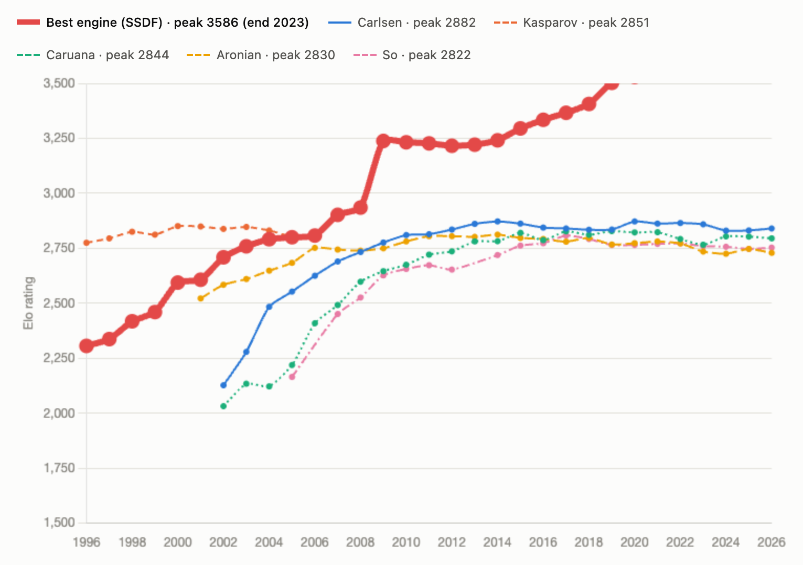
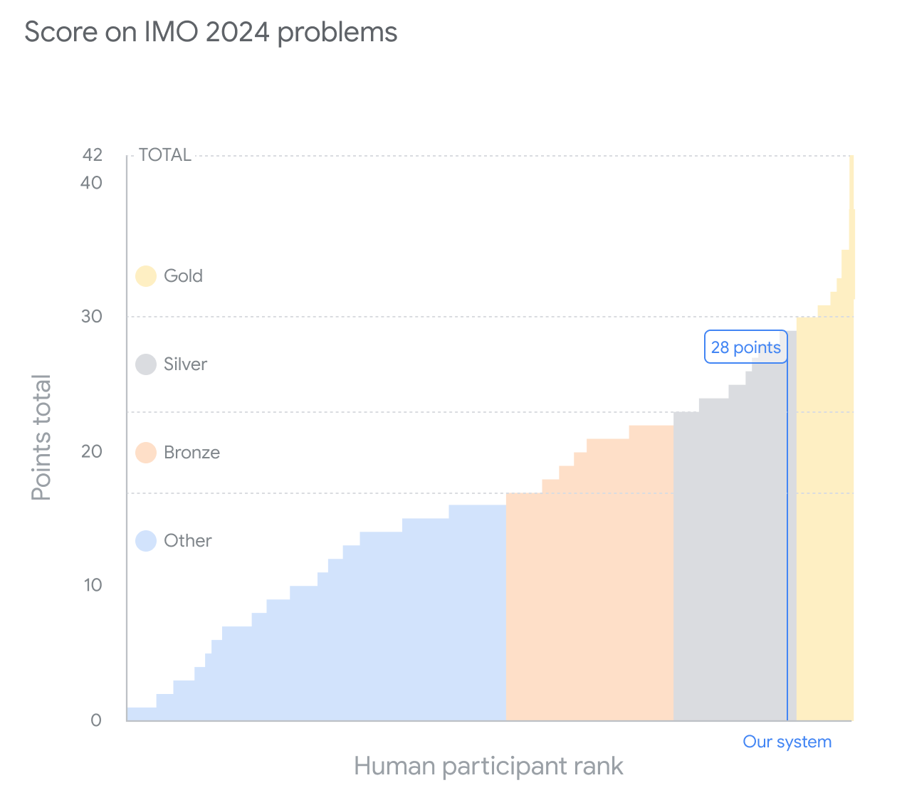
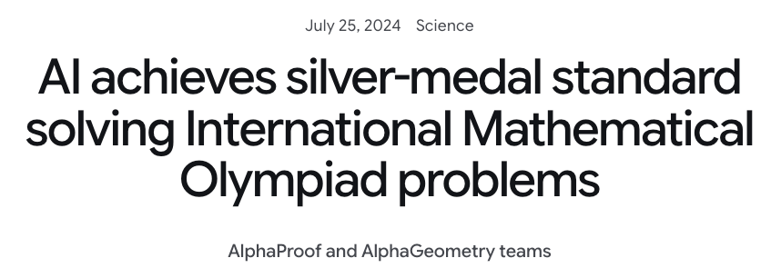
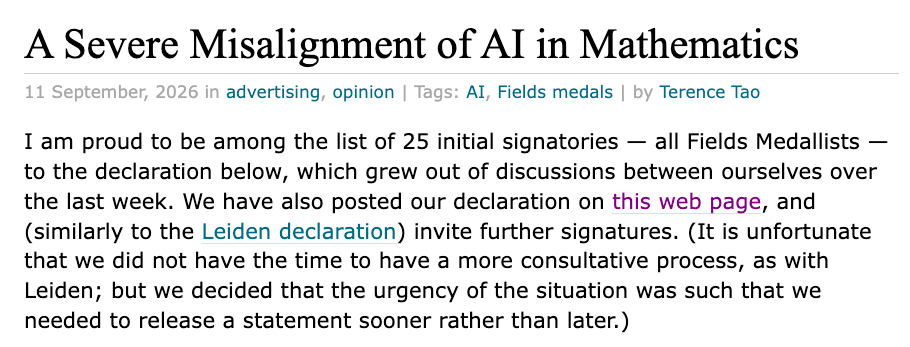
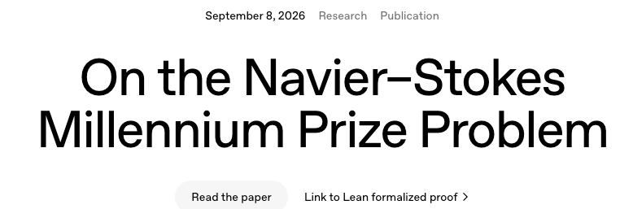

---
# You can also start simply with 'default'
theme: seriph
addons:
  - "@twitwi/slidev-addon-ultracharger"
addonsConfig:
  ultracharger:
    inlineSvg:
      markersWorkaround: false
    disable:
      - metaFooter
      - tocFooter

background: /nn-mj-wjcpq7Ov5x.jpg

# some information about your slides (markdown enabled)
title: LLM Benchmark for Postdoc-level Natural Science Problems
subtitle: some subtitle
date: 07/11/2026
venue: HSE
author: Alexey Boldyrev
info: |
  ## LLM Benchmark for Postdoc-level Natural Science Problems
  30-minute talk, FCS Scientific Conference, HSE Voronovo, 7 November 2026.
# charts are drawn for a light background
colorSchema: light
duration: 30min
# apply unocss classes to the current slide
class: text-center
# https://sli.dev/features/drawing
drawings:
  persist: false
# slide transition: https://sli.dev/guide/animations.html#slide-transitions
# transition: slide-down
# enable MDC Syntax: https://sli.dev/features/mdc
mdc: true
---

 

## LLM Benchmark  for Postdoc-level Natural Science Problems  
### FCS Scientific Conference  
### Alina Avanesyan, <u>Alexey Boldyrev</u>, Denis Derkach, Mary Godunova, Mikhail Hushchyn, Dmitry Ilvovsky, Irina Knyazeva, <u>Fedor Ratnikov</u>, Ekaterina Trofimova  

 

#### HSE Voronovo  November, 7th, 2026

<!--
Good morning. I will talk about how we test whether large language models can do real scientific work, not textbook exercises, and why we put so much effort into making those tests reproducible.
-->

---

# Chess rating

**How to measure?**

<v-clicks>

- head-to-head comparison tests
- a well-defined metric
- win / loss / draw

</v-clicks>

AI overtook humans and kept going, without slowing down: **no biological limits**.

<!--
Chess is the classic case of a clean measurement: games, a well-defined metric, win, loss or draw. Engines passed the best humans long ago and kept climbing, because they have no biological limits.
-->

---

# IMO

  
  
2026 (42/42)

  
2025 (35/42)

  
2024 (28/42)

  

AI solves mathematical olympiads

  

  
  

    
    

    

    
We are somewhere here?

  

<!--
Mathematical olympiads: in 2024 a system got 28 of 42 points, a silver-medal standard. In 2025 it scored 35, and in 2026 the full 42.

Compare this with the chess chart: where on that curve are we now? Somewhere around the moment when the engine caught up with the best humans.
-->

---

# Olympiads of the future

Olympiads need problems that are

<v-clicks>

- hard enough that few people can solve them
- simple enough to be solved in a day

</v-clicks>

Creating such problems for assessment **at the limit of intelligence** is hard.

Creating such problems for assessment **beyond the limit of intelligence** is practically impossible.

…and what for?

<!--
An olympiad needs problems that are hard enough that few people can solve them, but simple enough to be solved in a day. Building such problems at the limit of intelligence is hard. Beyond that limit it is practically impossible. And then, what is the point?
-->

---

# Exact sciences

**Strictly formalised**

- tasks are well defined

**Use logic**

- well suited to demonstrate AI capabilities

  
  

<!--
Exact sciences are strictly formalised, and they rely on logic, so they are a natural showcase for AI. But even here the community is not unanimous: Fields medallists have published a statement about a severe misalignment of AI in mathematics.
-->

---

# Benchmarks of AI models

Suppose that for mathematics (and other exact sciences?) AI capability benchmarks are evil and lead to degradation…

How should AI developers compete for users, attract them to new releases, and justify that model X is the best?

  
  

Key theses of the Fields medallists' open letter ("A Severe Misalignment of AI in Mathematics"):

- **Marketing benchmarks:** AI companies use great mathematical problems to show off computing power, not for genuine scientific understanding.
- **Loss of the value of the journey:** the chase for instant AI answers devalues the human search of many years that created new areas of mathematics.
- **The "black box" problem:** bulky AI-generated proof texts lack human intuition and demand colossal effort from mathematicians to decipher.
- **Education crisis:** AI dominance in solving key problems destroys the intelligible environment and the motivation for training young researchers.
- **Threat to open science:** fearing hidden plagiarism and idea capture by AI companies from private sessions, scientists will stop sharing intermediate results.

<!--
If benchmarks really harm mathematics, as the open letter argues, then how do AI developers show that their model is better? We need benchmarks, but benchmarks that measure something real.
-->

---

# Natural sciences

- Cognition of externally given entities
- No rigorous solutions
- No exact answers
  - any measurement has a confidence interval
  - any prediction has a confidence interval

How to assess the correctness of a measurement or prediction?

<v-clicks>

- internal self-consistency
- consistency with existing observations
- authoritative subjective assessment of correctness by experts

</v-clicks>

<!--
Natural sciences are different. We study entities that are given to us from outside, there are no rigorous solutions and no exact answers: every measurement and every prediction comes with an interval. So correctness has to be judged by self-consistency, agreement with observations, or, in the end, by expert opinion.
-->

---

# Task levels

| Level | Task |
|---|---|
| **"Bachelor"** | a well-defined technical task |
| **"Master"** | a well-defined goal; choose a suitable method independently and obtain the answer |
| **"PhD student"** | a well-defined direction; set a specific goal independently and achieve it |
| **"Postdoc"** | a general problem; determine the direction of the solution independently and implement it |

 

- Olympiad problems are well-defined "sporting" tasks, formally of the **"Master"** class
- In reality, olympiad problems lie **outside the class of scientific tasks**: the right answer and the scoring metric are known in advance

Scientific papers usually present tasks of the **"PhD student"** and **Postdoc** classes. **Postdoc**-level tasks are typically open-ended.

<!--
We grade tasks by the independence they require. A bachelor task is a technical exercise. A master task has a goal but you choose the method. A PhD student picks the goal inside a direction. A postdoc gets only a general problem. Typical papers solve PhD-student-class tasks, and everything from master upward is open-ended.
-->

---

# Requirements for a benchmark

<v-clicks>

- Must assess **reasoning**, not the model's memory?
- Must be **reproducible**?
- Must assess the **best, median or worst** solution?
- Must give a **quantitative** score?
- Must be **sensitive** to model quality
- Must not be **too specialised**

</v-clicks>

<!--
What do we need from a benchmark? It should test reasoning and not memory, give a number, be sensitive to model quality, and not be too narrow. Two requirements are still open questions: reproducibility, and whether we score the best, the median or the worst solution. The rest of the talk is our answer.
-->

---

# LLMs are acing science exams

<v-clicks>

- **Olympiad level.** An agentic system scored 23.5 / 30 on the IPhO 2025 theory problems, placing 14th of 406 contestants
- **Research calculations.** A Harvard theorist guided an LLM through a real calculation from start to finish, without touching a file himself
- **"AI scientists".** Autonomous agents run literature → analysis → hypothesis loops for hours. Experts judged 79% of one system's report statements accurate

</v-clicks>

  
Can an LLM do the work of a <b>postdoc</b>?

  
How do we <b>measure</b> it, so that anyone can <b>re-measure</b> it?

Qiu et al. 2025 (Physics Supernova) · M. Schwartz, "Vibe physics: the AI grad student", Mar 2026 · Mitchener et al. 2025 (Kosmos)

<!--
The progress is real. Olympiad problems, guided research calculations, autonomous "AI scientist" loops.

So the natural question is whether an LLM can do what a postdoc does. As physicists we immediately ask a second question: how do we measure that, in a way someone else can repeat and get the same number? That second question runs through the whole talk.
-->

---
zoom:1.2
---

# Encapsulating the pipeline

 

  

    
<carbon-virtual-machine class="inline" /> VM · with GPU · no internet access

    

      
<carbon-container-software class="inline" /> Docker

      
<carbon-bot class="inline" /> Model's commands

    

  

 

Model commands are executed **inside Docker inside a VM**, with TPU and without internet access. We do not take the tested models at their word.

<!--
The commands of the model are executed inside Docker inside a VM. The VM has a TPU and no internet access. We do not trust the tested models on their word: everything they do happens in a closed box that we control.
-->

---
zoom: 1.1
---

# Choosing the domains

<v-clicks>

- Neither too narrow nor too broad
- Natural-science problems built around **data processing and analysis**
- Fields where the team members have **scientific expertise**:
  - High-energy physics
  - Astrophysics and solar physics
  - Neural data analysis

</v-clicks>

<!--
The domains should be neither too narrow nor too broad. We take natural-science problems that revolve around data processing and analysis, in areas where members of our team have real scientific expertise: high-energy physics, astrophysics and solar physics, and neural data analysis.
-->

---
zoom: 1.2
---

# Statistical analysis

**Every run of every model is unique**

<v-clicks>

- the model may use different approaches
- the model may generate different features
- the model may run out of time
- the model may run out of tokens
- …

</v-clicks>

  
In the pilot project we made three runs each

  
<b>Best run</b> – the model's potential

  
<b>Worst run</b> – the guaranteed result

  
<b>Median run</b> – a compromise

<!--
Each run of each model is unique. The model can choose different approaches, generate different features, run out of time or run out of tokens. In the pilot we did three runs per model. The best run shows the potential of the model, the worst run is the result you are guaranteed to get, and the median is a compromise.
-->

---

# The grader problem

**Solving a natural-science problem is not reducible to a single number**

<v-clicks>

- the **correct error** matters (confidence interval)
- **a priori assumptions** must hold
- it matters how useful the result is for **downstream tasks**

</v-clicks>

In the pilot project we merged the multiple requirements into one aggregated, **physically motivated metric**. Its reasonableness was confirmed by domain experts.

<!--
Solving a natural-science problem is not reducible to one number. The error has to be right, which means a correct confidence interval. The a priori assumptions have to hold. And the result has to be useful for downstream tasks. In the pilot we collapsed all these requirements into one aggregated, physically motivated metric, and domain experts confirmed that it is reasonable.
-->

---

# The role of experts

**A specialist in every detail of the task.**

  

    
<carbon-settings />

    <b>Controls</b>
    <ul class="mt-2">
      <li>task description and formulation</li>
      <li>content and organisation of the data</li>
      <li>samples and signatures of baseline and "good" solutions</li>
      <li>calculation and aggregation of the quality metric</li>
    </ul>
  

  

    
<carbon-view />

    <b>Monitors</b>
    <ul class="mt-2">
      <li>the delivered solutions</li>
      <li>reasoning traces along the way</li>
    </ul>
  

  

    
<carbon-warning-alt />

    <b>Detects</b>
    <ul class="mt-2">
      <li>data leaks</li>
      <li>leaks of formulations</li>
      <li>physicality of solutions</li>
    </ul>
  

<!--
The expert is a specialist in all details of the task. The expert controls the task description, the data, the reference baseline and good solutions, and the computation and aggregation of the metric. The expert monitors the delivered solutions and the reasoning traces. And the expert detects data leaks, leaks of formulations, and unphysical solutions.
-->

---
layout: statement
---

# Models have no scientific ethics

The quality of the assessment is determined by the experience and the work invested by the expert.

<!--
Models have no scientific ethics. So the quality of the assessment is determined by the experience and the labour that the expert invests.
-->

---

# From tool to scientist

| Level | LLM's role | Human's role | Task scope |
|---|---|---|---|
| **1 · LLM as tool** | automates a task | allocates tasks | explicitly defined |
| **2 · LLM as analyst** | models and analyses data | defines the problem, validates the output | goal-oriented |
| **3 · LLM as scientist** | explores, discovers | minimal intervention | open-ended |

**Postdoc level** sits between 2 and 3. Given a well-posed research problem and real data, the agent delivers a method the field would accept, with nobody checking each step.

Levels from Zheng et al., "From Automation to Autonomy: A Survey on LLMs in Scientific Discovery", EMNLP 2025

### Well-posed research problem doesn't exist, only engineering (ML) problems can be truly well-posed.

<!--
A useful vocabulary: three levels of autonomy. Literature search and idea generation are fairly mature. Closed-loop analysis on real data is not.

By "postdoc level" we mean: someone hands you a well-posed research problem and the data, and you come back with a working method that your field would accept. That is what we want to measure.
-->

---

# How do today's benchmarks decide who is better?

  

    
<carbon-checkmark-outline />

    <b>Answer key</b>
    
GPQA, PHYBench, UGPhysics, olympiads

    <i>Is the final number right?</i>
  

  

    
<carbon-terminal />

    <b>Tests &amp; checks</b>
    
SciCode, ScienceAgentBench, Terminal-Bench-Science

    <i>Does the code pass?</i>
  

  

    
<carbon-chart-line />

    <b>Leaderboard rank</b>
    
MLE-bench  (Kaggle competitions)

    <i>Where would you place?</i>
  

  

    
<carbon-user-multiple />

    <b>Expert</b>
    
Humanity's Last Exam, MT-Bench (expert part)

    <i>Does it look right to a reviewer?</i>
  

  

    
<carbon-bot />

    <b>LLM judge</b>
    
PaperBench, COMPOSITE-STEM, LifeSciBench

    <i>Have all the criteria been met?</i>
  

None of these is how a scientific field decides that one method beats another. A check **accepts or rejects**. A field **orders** competing methods on a continuous figure of merit, measured on data nobody has seen.

<!--
Existing benchmarks replace the hard question with an easier one: an answer key, a unit test, a leaderboard position, or a rubric applied by a human or another LLM.

All four are useful, but none of them is how physicists actually decide that a new method is better. Two solutions can both "pass" and still differ by exactly the quantity the field cares about. And a rubric graded by an LLM cannot be re-executed bit for bit.
-->

---
zoom: 1.05
---

# An exercise vs. a research problem

| | Exercise | Research problem |
|---|---|---|
| **Solutions** | well-defined correct answer | many admissible methods, *ranked* by quality |
| **Deliverable** | a number or a formula | working code and a model that generalise to unseen data |
| **Data** | fits in the prompt | 0.1–10+ GB; deciding what to look at is part of the job |
| **Scoring** | right / wrong | the field's figure of merit with the correct error (right coverage) of the result number |
| **Failures** | directly visible from the answer | silent: data leakage, unphysical models; only withheld data exposes them |
| **Ceiling** | 100% | empirical: e.g. 0.75 AUC is the published limit for cross-scanner autism diagnosis |

<carbon-idea class="inline text-[#5d8392]" /> In every one of our tasks, the gap to the expert is closed by a **domain insight**, not by more compute

<!--
This table is the core of our problem formulation. Research problems have many admissible solutions that are ranked, not graded. The deliverable is working code, not a number. Data does not fit in a context window. The metric is the one the community uses. Failures are silent: a model can reproduce a spectrum while violating the physics, and only withheld data reveals it. And the ceiling is empirical, not 100%.
-->

---

# Key idea: let each field judge by its own rules

<v-clicks>

- Each problem is scored by the **figure of merit its community already uses** to compare published methods
- Two **anchors**: "baseline" ($b$) and "expert" ($e$), both obtained by *running code we ship*
  - baseline - minimal solution (e.g. random choice for classification problem)
  - expert - use some domain knowledge. Not necessary just the best

</v-clicks>

  <AnchorAxis />

The expert anchor is a reference, not an upper bound. Agents can and do exceed it.

<!--
Our answer: adopt the field's own criterion. Each task is scored by the metric its community uses to rank published methods.

And each task ships two anchors, measured by running code we include: a baseline that a capable engineer would write without domain knowledge, and an expert solution that reproduces a published method end to end.

The interval between them, the headroom, is the part of the problem crossed by scientific insight rather than engineering. That is what we read agent scores against.
-->

---
zoom: 1.15
---

# Three sciences, twelve research problems

  
Particle physics ×4

  
big data, hypothesis-free search

  <ul>
    <li>New-physics search at the LHC, no labels <em style="color:red">0.33→0.91</em></li>
    <li>Higgs signal strength with honest error bars <em style="color:red">0.40→0.69</em></li>
    <li>Top-quark jet tagging <em style="color:red">0.06→0.88</em></li>
    <li>Anomaly detection, signal never shown <em style="color:red">0.00→0.22</em></li>
  </ul>

  
Astrophysics ×3

  
ill-posed inversion with uncertainty

  <ul>
    <li>Solar magnetic fields from polarised spectra, simulated <em style="color:red">0.01→0.62</em></li>
    <li>… from real Hinode telescope data <em style="color:red">0.00→0.60</em></li>
    <li>Type Ia supernovae from sparse light curves <em style="color:red">0.42→0.85</em></li>
  </ul>

  
Neuroscience ×5

  
forward models, cross-site generalisation

  <ul>
    <li>Autism from fMRI, on unseen scanners <em style="color:red">0.00→0.31</em></li>
    <li>Identify the neural-mass model family <em style="color:red">0.00→0.90</em></li>
    <li>Digital twin: predict an intervention's effect <em style="color:red">0.10→0.72</em></li>
    <li>Recover hidden brain-model parameters <em style="color:red">0.13→0.52</em></li>
    <li>Recover neural drive from BOLD signal <em style="color:red">0.01→0.35</em></li>
  </ul>

<em class="anch">b→e</em> measured baseline → expert anchor; scores in&nbsp;&#91;0,&nbsp;1&#93;, higher is better. All datasets openly licensed (Zenodo, public challenges, ABIDE data-use agreement, open solar data, in-project simulation).

<!--
Twelve problems in three domains, chosen because they stress different abilities. Particle physics brings huge datasets and searches where you do not know what you are looking for. Astrophysics brings inverse problems with uncertainty. Neuroscience brings forward models and generalisation across clinical sites.

The grey numbers are the two anchors. Look at the autism task: the expert reaches only 0.31. That is not a weak expert, it is the real ceiling of cross-scanner clinical data.
-->

---
zoom: 1.05
---

# Close-up: reading the Sun's magnetic field

**Task.** From a polarised spectrum ($4$ Stokes profiles × $56$ wavelengths), recover $11$ physical parameters with $80\%$ intervals, for $10\,000$ pixels.

**Physics traps, by design**:
- azimuth is defined only modulo $180^\circ$
- some parameters are *exactly* unobservable at singular points
- a weak field filling the pixel ≈ a strong field filling part of it

 

> #### **The agent has to build a physics model to mitigate those traps.** The grader then generates spectra from the predicted parameters in an isolated container.

  

  $$\text{Score} = 0.8\,R + 0.2\sqrt{R\cdot F}$$

  

  

  - **R**: calibrated parameter recovery, relative to a no-skill predictor
  - **F**: does *your* physics reproduce the observed spectrum? Scaled by physical-validity probes
  - Why this score?
     - The geometric gate means a perfect spectral fit with nonsense parameters earns nothing

  

<!--
One task in detail, to show what "research problem" means in practice. Solar physicists infer the magnetic field from polarised spectra. There are built-in traps: a 180-degree ambiguity, parameters that are physically unobservable in some pixels, and degeneracies.

The agent must also submit its own forward model. Note the square root in the score: you cannot win by fitting the spectrum while getting the physics wrong. This is how we defend against gaming the metric.
-->

---
zoom: 1.1
---

# How one evaluation run works

  

    
<carbon-document /> Task

    research question in plain language 
    public data only 
    required submission format
  

  
→

  

    
<carbon-bot /> Agent in an offline sandbox

    LLM in a reason → act loop 
    tools: <code>bash</code> · <code>python</code> · data explorer · format validator (never reveals the score) 
    budget: 1 h · 10⁶ tokens · 200 messages · <b>no internet</b>
  

  
→

  

    
<carbon-scales /> Grader, outside

    withheld test split 
    deterministic metric μ ∈ &#91;0,&nbsp;1&#93; 
    + reproducibility verdict
  

  <carbon-recording class="inline" /> <b>Every run is recorded:</b> each message, tool call, token, dollar, run setting and score, in the open log format of the <a href="https://github.com/UKGovernmentBEIS/inspect_ai">Inspect framework</a>. Any run can be replayed and audited.

Same system prompt, same six tools and same budget for every model and every task. Ground truth never enters the sandbox. Without internet, a problem with a published solution can't turn into a search exercise.

<!--
The mechanics. The agent reads the task and the public data, works in an offline container with a few generic tools, and submits files. The grader runs outside the container on data the agent never saw.

Two design choices matter for reproducibility. First, everything is fixed across models: prompt, tools, budget. Second, every run leaves a complete log we can replay.
-->

---
layout: statement
---

# A benchmark is a measuring instrument

<!--
Now the part that matters most to us. We come from experimental physics, where a number without a protocol and an uncertainty is not a result. A benchmark is a measuring instrument for models, and it deserves the same standards.
-->

---
zoom: 1.1
---

# Why LLM evaluations are hard to reproduce

 

  
<carbon-shuffle class="ti" /> <b>Stochastic models.</b> For reasoning models, our API route doesn't even expose the sampling temperature

  
<carbon-renew class="ti" /> <b>Moving targets.</b> Providers update models and routing behind the same name

  
<carbon-warning class="ti" /> <b>Single runs.</b> One lucky or unlucky run gets reported as "the" score

  
<carbon-version class="ti" /> <b>Drifting setups.</b> Package versions, data versions, task revisions, run limits

  
<carbon-user-multiple class="ti" /> <b>Subjective judges.</b> Rubric or LLM-judge scores can't be re-executed

  
<carbon-cloud-offline class="ti" />
<b>Complex infrastructure.</b> Non-negligible fault probability

Each of these can move a headline number more than the difference between two models.

<!--
Why is this hard for LLMs specifically? The model itself is stochastic and, for reasoning models through our gateway, we cannot even set the temperature. Providers change models under the same name. Infrastructure fails silently. Setups drift. Judges are subjective. And people report one run.

Each of these effects can be larger than the gap between two models on a leaderboard.
-->

---
zoom: 1.12
---

# Reproducibility by design

| Threat | Our answer |
|---|---|
| <carbon-data-base class="inline"/> data drift | SHA-256 checksum for every data file; **any mismatch blocks the run** |
| <carbon-cube class="inline"/> environment drift | one container image per domain, identical for all models; network off; public data read-only |
| <carbon-certificate-check class="inline"/> numbers quoted from papers | baseline and expert **ship as runnable code**; smoke tests re-grade them and reproduce the anchors |
| <carbon-scales class="inline"/> subjective judging | **deterministic graders**, no LLM judge; written independently of the expert solution |
| <carbon-recording class="inline"/> lost evidence | full log of every run: dialogue, tool calls, tokens, cost, **run config**, score |
| <carbon-script class="inline"/> irreproducible agent output | the agent must ship a script + README that regenerates its outputs. The **validity flag is reported separately** from the score |

<!--
Here is how we answer each threat. Data are frozen by checksums, and a mismatch refuses to start the run. The environment is a container per domain, the same for every model. Anchors are not quoted from papers; we ship the code and re-run it. Grading is deterministic, with no LLM judge. Every run is logged, including the configuration it actually ran with.

The last row is easy to miss: we also require the agent's own solution to be reproducible. It must leave a script that regenerates its predictions. We report that flag separately from the score.
-->

---
zoom: 1.2
---

# Experiments statistics

> ## $288$ retained runs: $8$ models × $12$ tasks × $3$ repeats

<v-clicks>

- **Runs are often bimodal**: they land near the best score or at zero. 14 identical runs on top tagging ranged from 0.06 to above 0.9
- **Infrastructure failures** (model API unreachable) are flagged automatically and excluded, *but stay visible* in the report
- **Genuine zeros stay in every mean.** A failed attempt is a result too

</v-clicks>

<!--
We never report a single run. Every model–task cell has three retained repeats, 288 runs in total. For one configuration we ran ten repeats: one run scatters by about 0.06, the mean of ten by about 0.02.

We also checked that the platform doesn't matter: the same task and model on our university cluster and on a cloud machine give the same score within the spread.

Runs are often bimodal, so a single run can mislead in either direction. Infrastructure failures are separated automatically from genuine failures, and genuine zeros count.
-->

---
zoom: 1.15
---

# Reproducibility issues

  
<b>1 · Launch notes vs. logged config.</b> A batch described as "extended limits + GPU" had actually run with the default limits. Only the config recorded in each run revealed it.

  
<b>2 · Confounded ablation.</b> Extended budgets lifted top tagging from 0.84 to 0.94, but the provider route changed at the same time. We report it as <i>not attributable</i> to the budget.

  
<b>3 · Stale pilot.</b> An early effort sweep predates task revisions and a GPU-access fix in the containers. It is reported, but kept out of the headline comparison.

  
<b>4 · Grader audit.</b> A forward model with the wrong azimuth law (5χ instead of χ) passed the physics checks. Checks hardened, regression tests added. Released scores were <i>not</i> silently changed.

Each would have produced a confident, but wrong conclusion. Logs and versioned task contracts turned them into footnotes.

<!--
This slide is my favourite, because it shows why the machinery is worth it. Four times our own infrastructure caught us.

A batch we believed had larger limits had actually run with the defaults; the logged configuration showed it. An ablation changed two things at once, so we refuse to claim a causal effect. A pilot predates fixes, so it stays out of the headline. And an audit of our own physics checks found a loophole, which we closed with regression tests rather than quietly rewriting published numbers.
-->

---
zoom: 1.
---

# In 7 of 12 problems agent beats the expert

8 frontier models · high reasoning effort · mean of 3 runs · identical prompt, tools and budget

 

<HeadroomChart />

<!--
Now the results. Each row is a task. The shaded band runs from baseline to expert; the dark tick is the expert. Grey dots are the eight models, the blue dot is the best one.

On seven of twelve tasks, at least one model's mean exceeds the reproduced published method: new-physics search, top tagging, Dark Machines, both solar inversions, supernova classification and neural-mass family identification. On five tasks every model stays below.
-->

---
zoom: 1.04
---

# Where agents still fall short

| Task | Best mean | Expert | What agent missed |
|---|---|---|---|
| Higgs signal strength with error bars | 0.48 | 0.69 | **calibrated uncertainty** |
| Brain-model digital twins | 0.31 | 0.72 | **causal** prediction of an intervention |
| Brain-model parameter recovery | 0.42 | 0.52 | **latent** inference through a noisy channel |
| BOLD deconvolution | 0.19 | 0.35 | **latent** inference, no stimulus timing |
| Autism from fMRI, unseen scanners | 0.29 | 0.31 | **cross-site** generalisation |

<v-clicks>

- The domain knowledge is crucially important here, but agents failed to get into it
- Also observed:
  - On digital twins the best agent is still closer to the baseline (0.10) than to the expert
  - Single runs do cross the expert on two of these (autism 0.314, parameters 0.583), so here **reliability** is the gap, not ability

</v-clicks>

<!--
The five remaining gaps share a pattern. They are about uncertainty estimation, causal and latent inference, and generalisation to new clinical sites. These are precisely the failures you cannot see by looking at the output; only held-out data exposes them, and that is why an LLM judge reading a report would miss them.

On two of these, individual runs do cross the expert line, so the problem is consistency.
-->

---

# There is no "best model for science"

<!--
Task wins and domain leadership come apart. DeepSeek leads particle physics, Gemini leads astrophysics and neuroscience, and Claude wins five individual tasks but leads no domain.

A simple variance decomposition makes the point quantitatively: 60% of the variation is explained by the task, only 12% by the model. So a single-number leaderboard for "science" is mostly measuring which tasks it happens to contain.
-->

---
zoom: 1.1
---

# Ability vs. reliability

 
  
Particle-physics domain score per model

  <ReliabilityDumbbell />

<v-clicks>

- On their **best** run, 6 of 8 models reach 0.63–0.71, the level of the expert anchors
- The spread between models comes mostly from **how often they fail**, not whether they can solve the task
- **Score is not validity.** 15 of 88 zero-score runs still delivered a valid, reproducible package. We report both
- Time cap hit: 42% of DeepSeek runs, 39% of MiMo, 6% of Gemini Flash. We measure capability **under a fixed budget**

</v-clicks>

<!--
Separating the mean from the best of three runs is revealing. Six of eight models can reach roughly the expert level in particle physics on a good run. What separates them is reliability.

And because we record validity separately, we know that a zero is not automatically a crash: some zero-score runs produced a perfectly valid, reproducible package that simply did not beat the baseline. Budgets also bind differently for different models, which is why we state that we measure capability under a fixed wall-clock budget.
-->

---

# Conclusions

<v-clicks>

1. **Science problems have no right answer key.** We approach answer by a combined score metrics favorable by the field experts
2. Frontier agents in our runs **beat reproduced published methods on 7 of 12** research problems
3. They still fall short on **uncertainty, causal and latent inference, cross-site generalisation**
4. There is **no single "best model for science"**: the task rather then model drives most of the variation
5. **Reproducibility is the backbone**: frozen data, fixed containers, deterministic graders, full logs, repeated runs, and an honest record of what went wrong

</v-clicks>

<!--
To summarise. Scientific problems need scientific criteria, anchored at both ends. With those criteria, frontier agents already beat reproduced published methods on most of our tasks, but they fail where science is hardest to fake: uncertainty, causality, hidden variables and generalisation. Rankings are task-dependent. And none of these statements would mean anything without the reproducibility machinery behind them. Finally, in our experiments the models showed no scientific ethics.
-->

---

# Limitations and next steps

### Honest limitations

- 3 runs per cell: stable rankings need more repeats and confidence intervals
- Agreement of the metrics with **blinded expert rankings** is not yet measured (target: Kendall τ ≥ 0.85)
- One agent design evaluated; the effort sweep covers one model only
- Container images are fixed per domain, but exact package digests are not yet frozen

### Next

- **Open release** of tasks, graders, anchors and harness with the paper
- An agent with a curated literature corpus per task
- Matched-route budget ablations
- New domains through the same task contract
- **Student projects (FCS):** checking agents' claims against their own logs · context budgets · red-teaming the metrics

<!--
Limitations we state openly: three runs per cell is not enough for confident rankings; we still have to show that our automatic metrics agree with blinded expert rankings; and we want to freeze the container digests.

Next: the open release with the paper, the literature-enabled agent, cleaner ablations, more domains. And for FCS students: we have well-defined thesis projects on top of the run logs and the metrics.
-->

---
layout: cover
background: /photo_2025-04-09_09-28-52.jpg
class: text-center
---

# Thank you!

### Questions?

Every number in this talk can be traced to a logged, re-runnable experiment.

---

# Backup: per-task scores for all models

---

# Backup: example of fragment of reasoning trace

